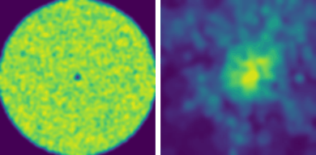

# Ergodic Trajectory Design by Learned Pushforward Maps: Provable Coverage via Conditional Flow Matching

**Ehsan Aghazadeh, Masoud Malekzadeh, Ahmad Ghasemi, Hossein Pishro-Nik**
University of Massachusetts Amherst · **NeurIPS 2026**

[**Project page**](https://ehsanaghazadeh.github.io/ergodic-pushforward/) ·
[**Paper (arXiv)**](https://arxiv.org/abs/XXXX.XXXXX) ·
[**NeurIPS proceedings**](#) <!-- replace with the official link once available -->

<p align="center">
  
  <br><em>The learned flow transports uniform occupancy on the latent annulus (s = 0) onto the Milano demand map (s = 1, right panel: target).</em>
</p>

An analytic latent trajectory covers an annulus uniformly and ergodically by
construction. A single map $G_\theta$, learned once offline with
optimal-transport conditional flow matching (OT-CFM), pushes that occupancy onto
any prescribed demand density. The composed path $x(t) = G_\theta(z(t))$ is
ergodic for the learned pushforward, and its deviation from the target is
controlled by the CFM training loss. The same map serves unlimited trajectories
and a whole fleet. Constraints such as no-fly zones, energy, and acceleration
enter as additive penalties in the training loss.

---

## Installation

```bash
git clone --recurse-submodules https://github.com/EhsanAghazadeh/uav_ot_cfm.git
cd uav_ot_cfm
python -m venv .venv && source .venv/bin/activate
pip install -r requirements.txt
pip install -e time_optimal_ergodic_search      # TOES baseline (upstream package)
pip install -r requirements_fmec.txt            # optional: FMEC baselines
```

If you cloned without `--recurse-submodules`, run `git submodule update --init`.
On a SLURM cluster, `bash scripts/install_env.sh` does the same with a
`module load python/...` step (edit the module name for your site).

Tested with Python 3.11, PyTorch ≥ 2.2, POT ≥ 0.9.

## Repository layout

| Path | Contents |
|---|---|
| `ot_cfm.py`, `latent_trajectory.py` | Velocity networks, OT (Sinkhorn) coupling, RK4 transport; annular latent domain $D_\delta$ and the radial latent trajectory |
| `run_otcfm_milano.py` | Train OT-CFM on Milano (with optional NFZ / energy / acceleration penalties) and roll out a trajectory |
| `run_baseline_milano.py`, `run_baseline_milano_v1.py`, `milano_baselines.py`, `toes_baseline.py` | Baselines: TOES, time-warping (NonUniformErg), static OT, SAC, FMEC-Stein / FMEC-Sinkhorn |
| `target_density.py`, `data/milano_grid_corrected.npy` | Milano demand density (50×50 grid) and loader with NFZ masking |
| `eval_fair.py`, `eval_prefix_stop.py`, `eval_nofly.py`, `eval_multi_agent.py`, `eval_amortization.py`, `eval_sampling_table.py` | Coverage, energy (Zeng rotary-wing model), NFZ violation, fleet and amortization metrics |
| `plot_*.py`, `method_style.py` | Paper figures (Pareto curves, trajectory grids, flow evolution) |
| `code_synthetic/` | Synthetic Experiments 1–3 (Gaussian mixture, binary 3:1 density, no-fly-zone constraints) |
| `train_synth.py`, `train_synth3d.py` | Appendix studies: latent radius $\delta$ ablation, spectral-norm certified bound, 3D extension |
| `eval_tracking_error.py`, `eval_turnaround_accounting.py`, `eval_fleet_separation.py`, `eval_expurgation_pv.py` | Appendix evaluations on saved Milano trajectories |
| `make_flow_animation.py` | Exports the latent → target flow animation used on the project page |
| `scripts/` | SLURM launchers for every experiment (3 seeds: 21, 42, 63 via `--array`) |

Every method writes a canonical `trajectory.npz` (`pos`, `times`, `domain`,
`method`, `meta`; see `fair_comparison.py`), so all evaluators are
method-agnostic.

## Reproducing the paper

The `scripts/*.sh` files are SLURM jobs. Submit them from the repo root
(`sbatch scripts/<name>.sh`), after adapting the `--partition`, `--gres` and
`module load` lines to your cluster. Each script also documents the exact
Python command, so it can be run without SLURM.

### Synthetic experiments (Section 4.1)

```bash
python code_synthetic/experiment_01_gaussian_mixture.py   # Experiment 1
python code_synthetic/experiment_02_binary_density.py     # Experiment 2
python code_synthetic/experiment_03_revised_v2.py         # Experiment 3 (NFZ at (0.5,-0.5), r = 0.2)
sbatch scripts/synthetic_multiseed.sh                     # Experiments 1-3 over seeds 0-4
```

### Milano UAV coverage (Section 4.2, Table 1)

Two no-fly configurations: single disc (1D, centre (0.19, 0.03), radius 0.1)
and four discs (MD, centres (±0.5, 0), (0, ±0.5), radius 0.2). All methods
use the same NFZ-masked target density.

```bash
# 1. OT-CFM, +NFZ, +E, +A, +NFZ+E, +NEA  x  {1D, MD}  x  seeds {21, 42, 63}
sbatch scripts/table1_otcfm.sh

# 2. Baselines: TOES, time-warp, static OT, SAC, FMEC-Stein, FMEC-Sinkhorn
CONFIG=1d sbatch scripts/run_baselines_nfz_masked.sh
CONFIG=md sbatch scripts/run_baselines_nfz_masked.sh

# 3. Table 1 metrics + coverage-energy Pareto curves (200 m domain,
#    time scale 10, 30 m/s speed cap with retiming)
sbatch scripts/table1_eval.sh

# 4. Fleet (1-20 agents) and amortization tables; NFZ trajectory grids
CONFIG=1d sbatch scripts/run_post_eval.sh
sbatch scripts/run_eval_nfz_focused.sh
```

The penalty weights in `table1_otcfm.sh` are the ones selected by the
single-seed sweeps in `scripts/sweep_*.sh` (Appendix "Constraint-Penalty
Sweep"). The remaining `scripts/run_*.sh` files are the individual
launchers used during development; they are kept for reference and may
point to exploratory configurations.

### Appendix studies

```bash
sbatch scripts/appendix_delta_sncap.sh   # δ ablation and spectral-norm certified bound
sbatch scripts/appendix_synth3d.sh       # 3D instantiation of the R^d construction
bash   scripts/appendix_scale_sweep.sh   # physical-scale sensitivity of Table 1
bash   scripts/appendix_evals.sh         # tracking error, turnaround accounting, expurgation, fleet separation
sbatch scripts/rerun_nea_seed63.sh       # +NEA seed-63 divergence (reported failure case)
```

## Data

`data/milano_grid_corrected.npy` is a 50×50 activity grid derived from the
Telecom Italia Milano mobile-traffic dataset (Barlacchi et al., *Scientific
Data* 2015). Preprocessing is described in the paper appendix
("Milano Dataset Preprocessing").

## Citation

```bibtex
@inproceedings{aghazadeh2026ergodic,
  title     = {Ergodic Trajectory Design by Learned Pushforward Maps: Provable Coverage via Conditional Flow Matching},
  author    = {Aghazadeh, Ehsan and Malekzadeh, Masoud and Ghasemi, Ahmad and Pishro-Nik, Hossein},
  booktitle = {Advances in Neural Information Processing Systems (NeurIPS)},
  year      = {2026}
}
```

## Acknowledgements

The TOES baseline uses the upstream
[time_optimal_ergodic_search](https://github.com/ialab-yale/time_optimal_ergodic_search)
package (included as a git submodule). FMEC baselines follow
Sun et al. (2025) and use [lqrax](https://pypi.org/project/lqrax/) and
[ott-jax](https://github.com/ott-jax/ott).
